<p align="center">
  
</p>

<p align="center">
  <a href="https://www.linkedin.com/in/william-kliemann-297b80a3"></a>
  <a href="mailto:wkliemannjr@gmail.com"></a>
  <a href="https://instagram.com/kliemann"></a>
  
</p>

<br/>

<p align="center">
  
</p>

> [!NOTE]
> **Este perfil é um pipeline.** Todo dia às 06h um GitHub Action extrai meus dados da API do GitHub, transforma e renderiza os cards acima e abaixo como SVG — sem serviços de terceiros. [Veja o código →](scripts/generate.py)

<p align="center">
  
</p>

## `$ cat stack.yaml`

```yaml
ingest:      [python, go, apis, ads platforms, event tracking]
store:       [postgres, sql server, mongodb, cloud warehouses]
transform:   [sql, pandas, numpy, medallion: bronze → silver → gold]
govern:      [datahub, data catalog, lineage, metric layer]
ai:          [llms, agents, mcp servers, tool use, rag]
platform:    [docker, nginx, linux, ci/cd, github actions, gcp, aws]
```

<p align="center">
  
  <br/><br/>
  
  
  
  
  
  
</p>

## `$ agent --list-principles`

| | |
|---|---|
| 🧱 **Dado bom é dado governado** | Métrica sem dono e sem linhagem é só um número bonito. |
| 🤖 **Agentes em cima de fundação sólida** | LLM em dado sujo só erra mais rápido. Primeiro o *gold layer*, depois o agente. |
| ⚙️ **Plataforma é produto** | Se o time precisa abrir ticket pra fazer deploy, a plataforma falhou. |
| 📈 **Decisão > dashboard** | O objetivo nunca é o gráfico — é a ação que ele provoca. |

<p align="right"><sub><code>refreshed daily by <a href=".github/workflows/refresh.yml">profile-agent</a> · built with Claude Code</code></sub></p>
